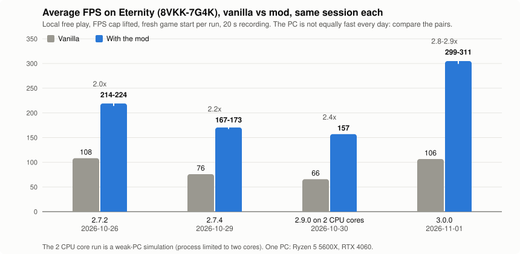

# UCH Game Performance: test results and progression

Author: Nexus. Last updated: 2026-11-01 (3.1.0). Companion to the [README](../README.md) and the [2.7.2 Eternity test report](eternity-test-report-2.7.2.md).

This page collects the measured results behind the mod, version by version: how the frame rate on a full level went from about 2x vanilla to close to 3x, what each step changed, and how the loading time was cut. All numbers come from the same test procedure described at the bottom.

## The headline

Eternity (level code **8VKK-7G4K**) is one of the heaviest community levels: about 4,000 blocks, 2,400 of them active, 1,700 wire pieces, 289 gameplay animations, 17 black holes, 2 ferris wheels and 20 to 40 arrows in the air at any time. It is the reference level for every number on this page.

| Session | Vanilla | With the mod | Gain | Slow frames per 20 s (vanilla / mod) |
|---|---|---|---|---|
| 2.7.2, 2026-10-26 | 108 FPS | 214 to 224 FPS | about 2.0x | 1,201 / 315 to 446 |
| 2.7.4, 2026-10-29 | 76 FPS | 167 to 173 FPS | about 2.2x | 1,188 / 979 to 1,036 |
| 2.9.0 on 2 CPU cores, 2026-10-30 | 66 FPS | 157 FPS | about 2.4x | 340 frames over 16.67 ms vanilla |
| **3.0.0, 2026-11-01** | **106 FPS** | **299 to 311 FPS** | **2.8 to 2.9x** | **1,199 / 120 to 143** |

"Slow frames" are frames longer than 8.33 ms, the budget for 120 FPS. The PC is not equally fast every day (the same build measured 167 FPS one day and 231 the next), so only the vanilla and mod runs of one session should be compared with each other. The gain is the number that carries over.

Level loading, measured on 2.7.2 and unchanged since (the loading code has not moved):

| | Portal entry to level ready | Longest freeze while loading |
|---|---|---|
| Vanilla | 29.8 s | 26.0 s |
| With the mod | 5.7 to 5.9 s | 2.0 to 2.1 s |

On a 10,700-block level the worst load freeze went from 21 s to 4.6 s and portal to ready from 25 s to 9.2 s.

## Version by version

Each row is a same-session A/B against the previous version, so the step is real even where the absolute FPS differs from the table above.

| Version | Date | What changed | Measured step on Eternity |
|---|---|---|---|
| 2.3.1 to 2.4.2 | 2026-10-25 | Loading: screen-wrap lookup cache, event sign-up lookup, buffered log file, no level compression in local play, fullness meter deferred, beehive bees disabled early, no GC during the level-start frame | Worst load freeze on a 2,900-block level 10.9 s to 1.2 s |
| 2.4.2 | 2026-10-26 | Static physics bodies for plain blocks that cannot move, with a watchdog that reverts any block that moves anyway | 115 FPS, median frame 9.6 ms (game's own 300 cap) |
| 2.5.1 | 2026-10-26 | Wider static rule (3,136 bodies), 1,250 purely visual animations culled off screen, 882 idle attachment indicators off | 176 to 182 FPS, median frame 3.6 to 3.9 ms |
| 2.6.0 | 2026-10-26 | Gameplay animations skip their pose writes while off screen, far ferris wheels skip rotation and catch up on return | 204 FPS, median 3.3 ms |
| 2.6.2 | 2026-10-26 | Correctness fix: any block whose animation moves a collider stays live while a player or projectile can reach it | About a third of the movers on Eternity stay live; the gain on this level is gone, kept on levels with few projectiles |
| 2.7.0 | 2026-10-26 | Static bodies for the root of bows, cannons, teleporters and similar; central per-step tick for wire, ice and glue; projectile travel segments for the reach check | 132 to 192 FPS in one back-to-back session (Discord and a browser open) |
| 2.7.2 | 2026-10-26 | First public release line: uncap option fixed, first full Eternity report | 108 vanilla to 214 to 224 (2.0x), load 29.8 s to 5.8 s |
| 2.7.3 / 2.7.4 | 2026-10-26 | Glove-to-glove chains fixed (a glove is never culled while its punch runs); static roots reduced to the proven types | Published as 2.7.4 |
| 2.7.4 baseline | 2026-10-29 | Attribution run: every slow frame is a physics-step frame; GC is irrelevant (one collection per 20 s) | 76 vanilla to 167 to 173 (2.2x) |
| 2.7.6 | 2026-10-30 | Static roots widened again to 14 proven block types; rotator fix (anything attached to a moving block keeps its normal body) | Base for the next A/B: 243 FPS |
| 2.8.0 | 2026-10-30 | Idle animator gate: gloves, crumble blocks, spikes, plants, beehives and cannons idle off screen have their animator switched off completely and are woken by the game call that needs them | 243 to 259 to 263 FPS, slow frames 217 to 141 to 170; wake latency identical to vanilla within one frame |
| 2.9.0 | 2026-10-30 | Teleporters added to the gate; update-script attribution | Found fan particle streams as the largest remaining per-frame script cost |
| 2.10.0 | 2026-10-30 | Off-screen fan particle streams not computed; wire, ice and glue loop skipped while nothing changed | 199 to 208 to 260 FPS, Update scripts 1.2 ms to 0.56 ms per frame |
| 2.11.0 / 2.12.0 | 2026-10-30 to 31 | Experiments: central tick for active blocks (no gain, kept off), slimmer block loop (inside noise) | Not shipped as a change in behaviour |
| 2.13.0 | 2026-10-31 | Static-block watchdog spread over 4 physics steps instead of checking every block every step | 319 to 327 FPS, slow frames 96 to 35, physics step 4.6 ms to 4.1 ms |
| 2.14.0 | 2026-10-31 | Fix for floating wire pieces in online games (parts removed right after placement with the same rule the placing player's game uses) | 309 and 299 (2.13.0) vs 322 and 304 (2.14.0): no regression, no per-frame work added |
| 2.15.0 | 2026-11-01 | Settings page with screen-tearing fix and FPS counter; all technical switches moved to the advanced config file | Functional checks only |
| **3.0.0** | 2026-11-01 | Public release of everything above | 106 vanilla to 299 to 311 (2.8 to 2.9x); FPS counter on costs nothing measurable (301 FPS) |
| 3.1.0 | 2026-11-01 | Uncap FPS switch and a customizable FPS counter on the settings page; same performance code as 3.0.0 | Not re-measured, identical performance code |

## Where the frame time went

Per-frame cost on Eternity by phase, in milliseconds, as the mod progressed (same PC, 20 s averages):

| Phase | Vanilla | 2.4.2 | 2.6.0 | 2.7.4 | 2.13.0 |
|---|---|---|---|---|---|
| Physics step | 3.40 | 1.95 | 0.82 | 1.05 | 1.53 per step |
| Fixed-step scripts (block routines) | 3.41 | 1.27 | 0.61 | 0.73 | 1.83 per step |
| Per-frame scripts | 1.63 | 1.57 | 1.04 | 1.29 | 0.46 |
| Animations | 2.73 | 2.36 | 1.05 | 1.48 | 0.58 |
| Rendering | 1.08 | 1.03 | 0.78 | 0.85 | 0.71 |

The vanilla and 2.7.4 columns are from the same session; 2.4.2 and 2.6.0 from an earlier one; 2.13.0 from a later one where the per-step phases were measured per physics step instead of per frame. The pattern is the point: the physics step and the per-block routines were the bulk of a vanilla frame, and animations were the largest remaining cost once those were cut. With all animators switched off as an experiment, 2.7.6 went from 231 to 388 FPS, which is why 2.8.0 to 2.10.0 concentrated on animations and off-screen work.

Things that were measured and turned out not to matter on this level: garbage collection (one collection per 20 s), particles (about 0.2 ms per frame), sprite renderer culling (0.03 ms), UI canvases (0.18 ms), background and post-processing (nothing). On a weak CPU only CPU work matters; no low-end graphics option was worth building.

## Does it change gameplay?

Every release was checked on Eternity and a set of smaller levels before it shipped:

- Hazards (spikes, saws, gloves, wrecking balls, flippers, doors, bows) end the same way for a test character with and without the mod.
- Arrows fire on the same physics step with and without the mod (every launcher on the level, same step number in both arms).
- Nothing out of view can affect a player or an arrow differently than in vanilla: a probe checks every paused animation and ferris wheel against every player and projectile path, 0 violations in every run.
- Blocks attached to rotators or other moving blocks keep their normal physics body and move exactly like vanilla (the 2.7.6 fix, re-checked in 2.14.0 with zero drift).
- The game's physics step, maximum time step, solver settings, gravity, layers and hitboxes are never written. A build check with over 58,000 IL assertions guards the patched game methods, and every option switches itself off with a log line if the game code looks different from what it expects.
- The wake latency of a gated animator (glove punch, crumble shake, spike trigger, plant punch, beehive hit) matches the ungated one within one frame.

## How the numbers were taken

- One PC: Ryzen 5 5600X, RTX 4060, Windows 11, 1920x1080, 240 Hz.
- Game: Ultimate Chicken Horse, current Steam build, BepInEx 5. Local free play, one keyboard player, invincible test character standing at the start of the level; nobody plays, the level runs its shooters, gloves, saws and wheels on its own.
- Profile: only this mod and the measurement plugin (UCH Perf Test). No other mods.
- FPS cap lifted to 1000 and VSync off for every run, otherwise the game's own 300 cap hides the difference.
- Fresh game start for every run, 15 s warm-up after the level reaches the play phase, then one 20 s recording with the game window focused and the PC otherwise idle.
- Vanilla = the mod's master switch off: the DLL is loaded but applies nothing.
- A/B order: mod, vanilla, mod (or old, new, old), all in one session. A run with the window unfocused, on the wrong monitor, or with a cold first arm is discarded or bracketed with a repeat.

Limits: one level, one machine. Numbers on other hardware will differ; the relative gain should hold wherever the physics step and the block scripts are the bottleneck, which is what full levels stress. Real rounds with players and online games were not benchmarked.

## Credits

Made by Nexus. Thanks to Nn for parts of the loading optimizer, the event-listener idea, the ferris-wheel idea and the rotator report, to Milena for testing, and to Bojack, whose BetterPerformance inspired some of the early optimizations.
